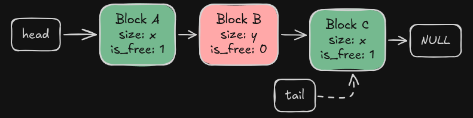

# s-memalloc (Saptaparno's memory allocator)

An experimental memory allocator written in C. `s_malloc` and `s_free` are implemented; `s_calloc` and `s_realloc` are pending.

This project is for my learning of how programs request memory from the OS, how memory is tracked, and how to manage it efficiently.

---

## Design

First of all, this is roughly what the memory layout of a program looks like:

The stack and the heap grow in opposite directions.

`s_malloc` requests memory with `sbrk`, which moves the program break (the end of the process's data segment). It stores a header before each returned block and tracks those headers in a linked list. When an existing free block is large enough, `s_malloc` reuses it; otherwise, it requests a new block from `sbrk`.

The memory blocks are kept in a linked list so the allocator can traverse and find reusable blocks:

`s_malloc` returns `NULL` for a zero-size request or if `sbrk` fails. `s_free` ignores `NULL`. It returns a block at the end of the heap to the system by moving the program break backwards. Other blocks are marked free so a later `s_malloc` call can reuse them. Access to the allocator's block list is protected by a mutex.

---

## Author

Saptaparno Chakraborty

---
