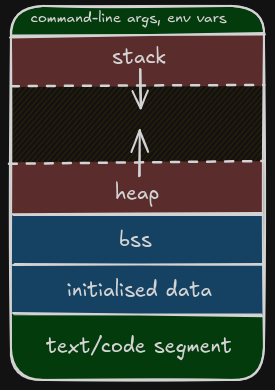

# s-memalloc (Saptaparno's memory allocator)

Reimplementing `malloc`, `calloc`, `realloc`, and `free` from scratch in C.

This is for my learning of how programs ask the OS for memory, how memory is tracked, and how to manage it efficiently.

---

## Design

First of all, this is roughly what the memory layout of a program looks like:

The stack and the heap grow in opposite directions.

The main mechanism I'm using to write this memory allocator is a system call called `sbrk` which manipulates the program break (brk, responsible for marking off the end of the heap).

The memory blocks are kept together in a linked list like this, to make it convenient to traverse through the blocks:

---

## Author

Saptaparno Chakraborty

---
